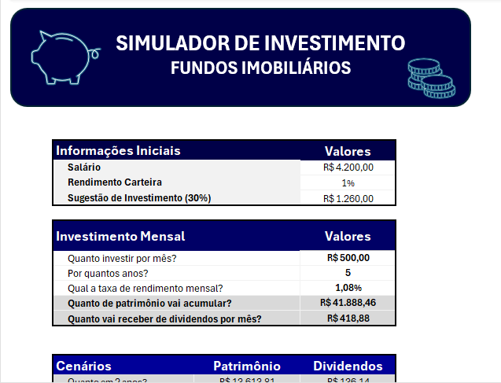
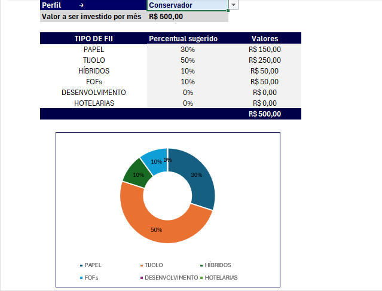
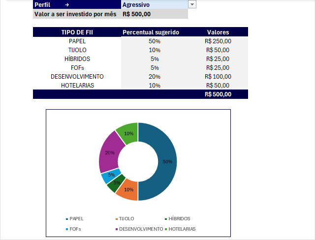

# dio_simulador

## Desafio DIO - Criar um simulador do Excel

### :rocket: **Introdução:**

Esse projeto faz parte de um dos desafios, Módulo de “Criando uma Ferramenta de Controle de Investimentos com Excel” do curso Santander - Excel com Inteligência Artificial, ministrado pelo Professor Felipe Aguiar (Felipão). 

### :dart: **Objetivo:**

O objetivo do projeto foi criar um simulador de investimentos de Fundos Imobiliários (FIIs) por meio de uma planilha do Excel. O intuito era responder cinco perguntas de negócio, a saber:
- Quanto investir por mês;
- Por quantos anos;
- Qual a taxa de rendimento mensal;
- Quanto de patrimônio vai acumular;
- Quanto vai receber de dividendos por mês.
 
Pelo simulador, é possível obter também a projeção do patrimônio para cenários de 2, 5, 10, 20 e 30 anos. Os cenários consideram seis tipos diferentes de fundos imobiliários (papel, tijolo, híbridos FOFs, desenvolvimento e hotelarias) e três perfis de investidor (Conservador, Moderado e Agressivo).

### :chart_with_upwards_trend: **Resultados:**

- Para o cálculo do patrimônio em diferentes cenários, foi usada a função ‘VF’ (valor futuro) do Excel, considerando a taxa de rendimento mensal, o tempo de investimento (em meses) e o valor a ser investido em cada mês.  
- A função ‘PROCV’ (Procurar Valor) foi usada para construir o quadro de percentual sugerido para cada perfil de investidor. Foi criada uma chave composta, formada pelo perfil de investidor e o tipo de fundo, para buscar o percentual sugerido para cada perfil. A seguinte imagem mostra a planilha auxiliar usada para suportar os cálculos:

- Para facilitar os cálculos, foram considerados intervalos nomeados, conforme mostra a imagem abaixo:

  
- As principais diferenças entre a ferramenta criada e apresentada no curso são as paletas de cores e o gráfico usado para os percentuais de cada perfil.
- As imagens abaixo mostram alguns resultados do simulador:

#### Topo do Simulador:
- Contém informações necessárias para a simulação, como o salário e o rendimento da carteira.
  

#### Sugestões de alocação de investimento de acordo com o perfil:

Nas imagens abaixo é possível visualizar as indicações de proporção de alocação em fundos imobiliários de para os perfis conservador e agressivo.

| Perfil conservador | Perfil agressivo |
| :------: | :------: |
|  |  |

A planilha com o simulador completo está no link [simulador de FIIS](https://github.com/samilasena/dio_simulador/blob/main/simulador_investimentos_fiis.xlsx) e pode ser usado para adaptar para outros tipos e investimentos ou em cenários que exijam cálculos, variando determinadas carcterísticas.

